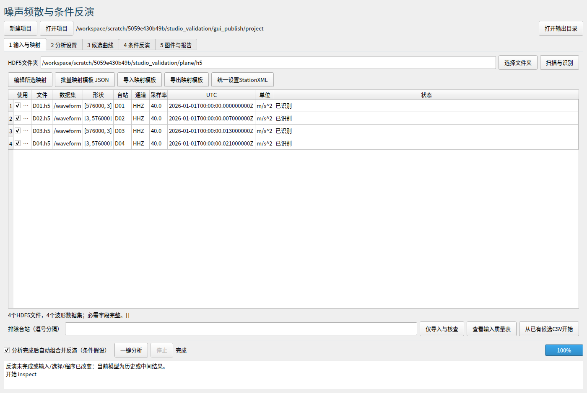
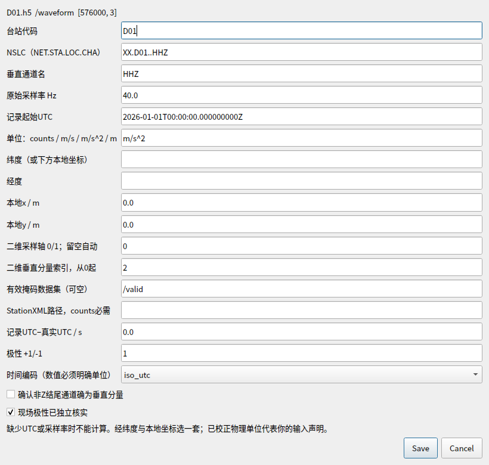
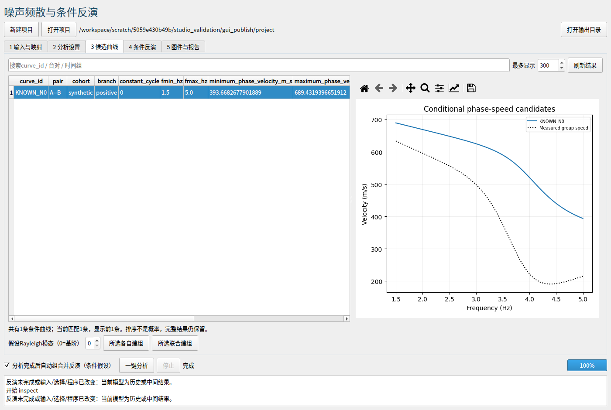
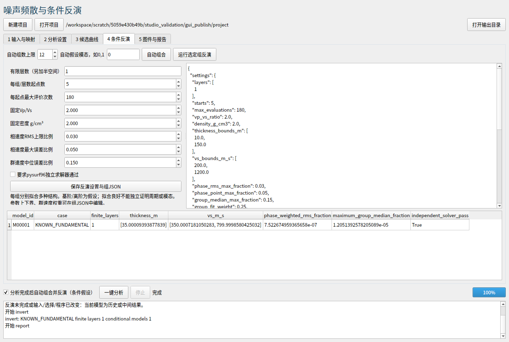
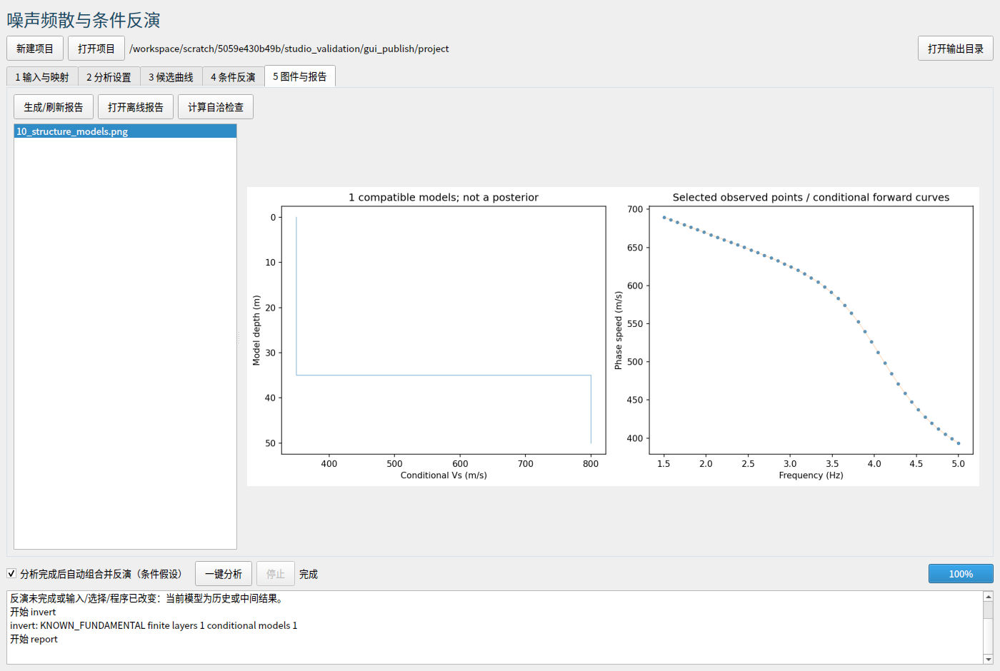

# 通用频散与条件反演程序：测试报告

2026-10-09 · Noise Dispersion Studio 2.0 · Python 3.12.14 / Linux。源码、固定版本依赖、Windows安装/启动批处理及GUI已完整提供；Windows入口尚未在Windows机器原生实测。

> 本次通过 46 项自动断言，失败 0 项、错误 0 项。另执行合成H5全流程、独立噪声全流程、Qt实际进程测试、已知模型反演及DARE候选分组反演。测试通过检验软件行为，不证明所有现实数据均能产生可靠或唯一的频散。

## 数值和工作流验证

| 项目 | 输入与检查 | 实际结果 |
|---|---|---|
| HDF5和时间 | 1D/两种2D顺序、明确分量、有效掩码、ISO9位/Unix明确单位、多文件重叠、错误字段拒绝 | 自动断言通过；冲突重叠、缺UTC、未知单位和counts缺响应均拒绝 |
| 原处理核心 | 授时重采样、响应历元、滤波/尖峰/局部尺度、重启与正演 | 原核心测试通过 |
| 4站4小时H5已知场 | 40Hz异步起点0/7/13/21ms，含尖峰/平线/缺测；2–5Hz传统互相关FTAN | 52共同窗，6验证相位段，124固定N候选；6台对均有接近真值候选，最大误差 0.0654% |
| 局部异常恢复 | 单样点尖峰、不插值长异常 | 共修复 1 原生样点，掩码 192 原生样点；异常所在窗口仍保留有效部分 |
| 独立噪声对照 | 相同几何、时间/异常和处理配置，台站独立随机场 | 52共同窗，0通过相位段、0频散候选；自动反演跳过并正常生成报告 |
| 已知层状Rayleigh基阶 | 层厚35m，Vs=350/800m/s，固定Vp/Vs=2、密度2；5起点 | 恢复H=35.000094m，Vs=350.000718/799.999858m/s；相速度RMS=0.000075% |
| 独立数值复验 | 所有实测频点使用disba与pysurf96分别正演相速度 | 已知模型最大差 0.000789m/s，通过；两者非独立地质证据 |
| 分组规则与假结果防护 | A–B–C相邻兼容但A–C不兼容、重复同台对、字符串false、缺根、缺独立求解器、选择改变 | 不把传递链当联合组；重复/质量不合格/预测混入观测会拒绝；失败保留原因 |
| GUI实际进程 | H5扫描、隐式保存601s设置、候选表/曲线、独立进程反演、报告、切换项目锁定 | 4条H5记录显示；反演期间UI计时器继续响应；5张实际窗口截图 |
| 完整自动路线 | H5→导入→预处理→扫描→错时→候选→验证→自动分组→反演→报告 | 全部请求阶段完成；合成标量场的前2个Rayleigh假设组无通过模型，记录拒绝，未伪造地下模型 |

已知场的“最近候选”是用合成真值在测试阶段比较得到；不意味着真实数据中程序已知正确N。124条候选作为多解仍保留。已知层状模型在生成和主拟合中使用disba，pysurf96另做相速度数值复验；这是恢复/实现测试，不是外部观测验证。

## DARE实际候选表试跑

使用此前法国DARE主片段2.31–5Hz、270点、夜间D02–A00的13周期备选表。本次不重新处理96小时原始数据，也不重新证明此前的波形验证。选N=3/4/5分别作为竞争假设，源相位pi/4、Rayleigh基阶、固定Vp/Vs=2、密度2，有限层数1/2，H范围5–500m、Vs范围150–2200m/s，每组每层数组4起点，共 24 次。

| 组 | 通过结构数 | 解释 |
|---|---:|---|
| N=3 / 基阶 | 5 | 当前1D/周期/源相位/模态假设下兼容 |
| N=4 / 基阶 | 4 | 当前假设下兼容，继续与N3保留竞争 |
| N=5 / 基阶 | 0 | 当前搜索范围和起点下未通过，不等于排除所有其他假设 |

9个通过结构均做了独立相速度数值复验；模型的相速度、群速度误差及边界标记写在JSON中。源相位、绝对周期、模态、现场极性与共同1D结构仍未独立核实；结构集没有正式后验概率或探测深度置信区间。完整13条候选继续保留在示例CSV。

## 实际界面

以下截图来自正在测试的Qt程序，不是界面示意图。已知模型图中的35m界面只代表合成测试。

### HDF5记录扫描与必需字段



### 单条字段映射和仪器/UTC声明



### 候选观测点与群速度比较



### 明确假设组及已知模型反演结果



### 条件Vs模型和实测点/预测对照



## 交付与复现

根目录README与使用手册覆盖全部步骤、字段别名、映射模板、人工选择、CLI、质量门槛、失败处理及输出含义。ZIP附合成H5、已知模型和DARE主段候选项目，未捆绑pip运行库或DARE原始96小时波形。

主要运行依赖锁定：NumPy2.3.5、SciPy1.17.0、pandas2.2.3、h5py3.16.0、ObsPy1.5.1、pyproj3.8.0、Matplotlib3.10.8、PySide6 6.12.0、disba0.7.0、Numba0.63.1。pysurf96 1.0.1为可选独立数值求解器，本次测试已安装。

```bash
python -m pip install -r requirements.txt -r requirements-test.txt
python -m pytest tests core/tests -q
python run.py example --directory examples/generated --field plane
python run.py all --project examples/generated/project --auto-invert --max-cases 2
python run.py example --directory examples/noise --field noise
python run.py all --project examples/noise/project --auto-invert
python run.py invert-example --directory examples/generated_model
python run.py invert-csv --curves examples/generated_model/curves.csv --selection examples/generated_model/selection.json --output examples/generated_model/output
```

GUI测试脚本为tests/gui_smoke.py；无显示服务器的Linux可设置QT_QPA_PLATFORM=offscreen后指定输出目录和H5文件夹。JUnit记录见pytest_results.xml。你的实际H5尚未用于本次测试；格式不符合支持布局时，需要补映射或拆分记录。
