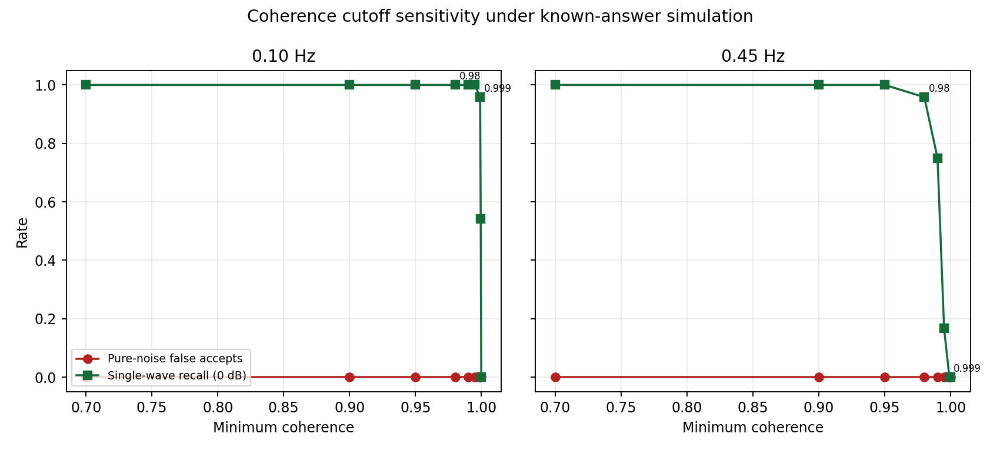
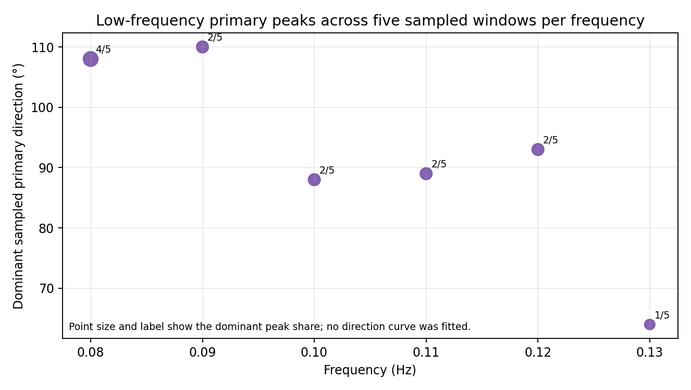
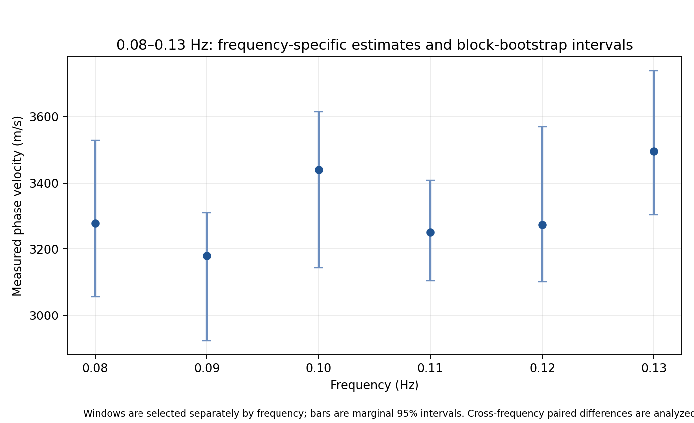

# MGS 六台 MUSIC 筛选验证报告

**数据时段：** 2023-11-01 至 2023-11-05 00:00 UTC（四个完整 UTC 日）  
**台站：** BW_MGS01、BW_MGS02、BW_MGS03、BW_MGS04、BW_MGS05、BW_MGSBH  
**处理基线：** 200 周期窗，NW=3.5、DPSS 快照 K=6；方向网格 2°、速度网格 128 点；自动 MDL 信号数；最低相干度 0.70。

## 结论

当前结果**不支持直接放宽 MUSIC 门槛**。已知答案单波仿真说明估计器能恢复理想单波，但不是实际多分支噪声场的充分验证。实际数据在 0.70 门槛下没有可用的前段参考；把相干度降到 0.40 或 0.50 后虽能恢复少量逐频参考，方向分支散乱且没有连续候选带。较低门槛的纯噪声仿真也出现了单窗误收。

此前按各频率分别挑窗计算出的 0.09→0.10 Hz 正增速，并未在相同 UTC 中心的配对重算中复现：观测配对差中位数约 **−5 m/s**，时间块 bootstrap 中位数约 −2 m/s、95% 区间 **−489 至 +673 m/s**。六个低频点只有 1/96 个共同 UTC 中心具备完整的单源、台对方向和相位速度。因此当前不做真实结构反演；对这六点也不能用先前的非配对正增速判定其不满足单调条件。

## 仿真恢复与误接受

仿真使用本次真实台站坐标，合成波形经过生产版 DPSS 窗、快照构造和 MUSIC 估计。单波测试每频率每 SNR 8 次，另有台站振幅相差约 28 dB 的测试每频率 12 次。下表是方向/速度误差；SNR 是时域信号对噪声功率比。

| f (Hz) | SNR (dB) | Accepted | Median azimuth error (°) | P90 azimuth error (°) | Median |velocity error| (%) |
|---|---|---|---|---|---|
| 0.100 | -5.0 | 8/8 | 0.4 | 0.6 | 0.45% |
| 0.100 | 0.0 | 8/8 | 0.1 | 0.3 | 0.25% |
| 0.100 | 10.0 | 8/8 | 0.0 | 0.1 | 0.06% |
| 0.100 | 20.0 | 8/8 | 0.0 | 0.0 | 0.02% |
| 0.450 | -5.0 | 8/8 | 0.0 | 0.1 | 0.10% |
| 0.450 | 0.0 | 8/8 | 0.0 | 0.0 | 0.05% |
| 0.450 | 10.0 | 8/8 | 0.0 | 0.0 | 0.01% |
| 0.450 | 20.0 | 8/8 | 0.0 | 0.0 | 0.00% |

200 个独立纯噪声试验（每频率 100 个）没有一个被最终接受；自动信号数为 q=0 的比例为 94%，其余 q=1 或 q≥2 样本也被后续质量门槛拒绝。此处观测误接受率为 0/100/频率；样本量有限，不能把它解释成误接受概率为零。

| f (Hz) | Pure-noise trials | q=0 | q=1 | q≥2 | Accepted |
|---|---|---|---|---|---|
| 0.100 | 100 | 94 | 2 | 4 | 0 |
| 0.450 | 100 | 94 | 2 | 4 | 0 |

相干度从 0.70 扫描至 0.98 时，已知答案单波在 0 dB SNR 下仍保持 24/24 与 23/24 的接受率，纯噪声保持 0/40 与 0/40。更高阈值会逐渐损失单波：模拟种子留出选择的阈值为 0.999（0.10 Hz）和 0.98（0.45 Hz），其留出单波保留率为 90%。但这些阈值迁移到真实数据后会拒绝 11 月 4 日 0.10 Hz 的全部窗口，因此没有应用到正式流程。

| f (Hz) | Trials | Accepted | Median azimuth error (°) | Median |velocity error| (%) |
|---|---|---|---|---|
| 0.100 | 12 | 12 | 0.1 | 0.18% |
| 0.450 | 12 | 12 | 0.0 | 0.04% |

独立窄带双波的 48 次测试中，46 次识别为 q≥2；仅 1 次低频样本被当作 q=1 接受，0.45 Hz 没有双波样本被接受。两个完全相干的同频正弦波会退化为 rank-1 的空间快照，20 次低频测试均被识别为 q=1；这类信号本身不能靠当前协方差快照区分两个波源，需与独立双波结果分开解释。

| f (Hz) | Independent dual-wave trials | q=1 | q≥2 | Accepted as one usable wave |
|---|---|---|---|---|
| 0.100 | 24 | 1 | 23 | 1 |
| 0.450 | 24 | 1 | 23 | 0 |

| f (Hz) | Coherent same-tone trials | q=1 | q≥2 | Accepted |
|---|---|---|---|---|
| 0.100 | 20 | 20 | 0 | 20 |
| 0.450 | 20 | 20 | 0 | 6 |

## NW、快照数和纯噪声特征值

单因素对照固定 NW=3.5 改 K=4/6/7，再固定 K=6 改 NW=3.5/4.0。每频率、SNR、参数组合的已知答案单波测试为 10 次。各组合都通过单波质量门槛；方向误差中位数范围约 0.009–0.116°，速度相对误差中位数均低于 0.30%。纯噪声对照每组合 12 次，最终接受数仍为零；0.45 Hz 下 K=7 的 12 个噪声窗均判为 q=0，K=6 有 9/12 判零源。

| f (Hz) | NW | K | Noise trials | q=0 | q=1 | q≥2 | Accepted |
|---|---|---|---|---|---|---|---|
| 0.100 | 3.5 | 4 | 12 | 10 | 1 | 1 | 0 |
| 0.100 | 3.5 | 6 | 12 | 12 | 0 | 0 | 0 |
| 0.100 | 3.5 | 7 | 12 | 12 | 0 | 0 | 0 |
| 0.100 | 4.0 | 6 | 12 | 12 | 0 | 0 | 0 |
| 0.450 | 3.5 | 4 | 12 | 5 | 3 | 4 | 0 |
| 0.450 | 3.5 | 6 | 12 | 9 | 3 | 0 | 0 |
| 0.450 | 3.5 | 7 | 12 | 12 | 0 | 0 | 0 |
| 0.450 | 4.0 | 6 | 12 | 10 | 2 | 0 | 0 |

因此快照数对纯噪声信号数的影响比 NW 对单波方向精度的影响更明显。当前仿真规模支持保留 NW=3.5、K=6 作为基线；尚不足以证明它在真实背景噪声波场中最优。

## 真实数据：台站、网格和多峰

0.10 Hz 逐站剔除对同一批 q=1 窗的方向中位变化为 0.17–1.46°，相速度变化中位数为 −0.65% 至 +0.86%。接受窗数从全六站的 18/32 变化到剔除单站后的 18–23/32。0.45 Hz 的全六站与所有逐站剔除对照均为 0/32 接受。网格由 2°/128 点加密到 1°/256 点后，0.10 Hz 两种网格各接受 4/12 窗；共同 q=1 窗方向与速度估计数值相同。

| Dropped station | Accepted windows / 32 | N | Median paired azimuth shift (°) | Median paired velocity change (%) |
|---|---|---|---|---|
| BW_MGS01 | 19 | 32 | 0.5 | -0.46% |
| BW_MGS02 | 21 | 32 | 0.4 | 0.05% |
| BW_MGS03 | 19 | 32 | 1.0 | -0.65% |
| BW_MGS04 | 23 | 32 | 1.0 | 0.79% |
| BW_MGS05 | 22 | 32 | 1.5 | 0.86% |
| BW_MGSBH | 18 | 32 | 0.2 | -0.40% |

| f (Hz) | N | 2° grid accepted | 1° grid accepted | Paired single-source windows | Median direction difference (°) | Median velocity change (%) |
|---|---|---|---|---|---|---|
| 0.100 | 12 | 4 | 4 | 5 | 0.0 | -0.00% |
| 0.450 | 12 | 0 | 0 | 0 | — | — |

每个低频点抽取 5 个有效窗口查看谱峰。占优峰方向在 0.08 Hz 的 4/5 个窗口中约为 108°；0.09–0.12 Hz 的占比降到 2/5；0.13 Hz 主峰分散，最高方向组仅占 1/5。该采样只能用于观察分支稳定性，不能独立证明哪个峰是物理传播分支。

| f (Hz) | Dominant peak azimuth (°) | Dominant windows | Sampled windows | Share (%) |
|---|---|---|---|---|
| 0.080 | 108.0 | 4 | 5 | 80.00% |
| 0.090 | 110.0 | 2 | 5 | 40.00% |
| 0.100 | 88.0 | 2 | 5 | 40.00% |
| 0.110 | 89.0 | 2 | 5 | 40.00% |
| 0.120 | 93.0 | 2 | 5 | 40.00% |
| 0.130 | 64.0 | 1 | 5 | 20.00% |

## 低频六点：边际区间与同中心配对结果

此前的 499 次时间块重采样分别汇总各频率的可用窗口，频率之间没有要求同一个 UTC 中心同时通过单源与台对门槛。因此这些逐频区间只能描述各频率的边际变化，不能把相邻频率差的区间当作同一窗口配对差，也不能据此断言速度随频率上升。原始测量点仍保留在表中；没有拟合或平滑曲线。

| f (Hz) | Observed azimuth | Azimuth 2.5% | Azimuth 97.5% | Observed projection (m) | Projection 2.5% | Projection 97.5% | Observed velocity (m/s) | Velocity 2.5% | Velocity 97.5% |
|---|---|---|---|---|---|---|---|---|---|
| 0.080 | 104.9 | 104.0 | 106.0 | 7,914.6 | 7,812.0 | 8,004.7 | 3,276.8 | 3,055.7 | 3,529.2 |
| 0.090 | 105.2 | 103.6 | 106.7 | 7,893.7 | 7,742.7 | 8,045.2 | 3,179.4 | 2,921.1 | 3,309.4 |
| 0.100 | 105.8 | 89.8 | 106.8 | 7,831.2 | 7,725.9 | 9,099.6 | 3,439.8 | 3,143.5 | 3,615.0 |
| 0.110 | 104.2 | 89.4 | 105.1 | 7,985.3 | 7,898.7 | 9,125.8 | 3,250.7 | 3,103.8 | 3,408.7 |
| 0.120 | 103.7 | 90.0 | 104.9 | 8,030.5 | 7,918.0 | 9,085.6 | 3,273.5 | 3,101.3 | 3,569.1 |
| 0.130 | 91.9 | 90.7 | 104.4 | 8,968.9 | 7,963.2 | 9,049.2 | 3,495.9 | 3,302.4 | 3,740.1 |

现补充同一 UTC 小时中心、同一六小时块同步重采样的相邻频率配对差。只有同一中心两频率均通过 q=1 方向、台对方向及 k=0 相位速度检查时才计算 Δv；少于 10 个配对中心或 4 个时间块时不报告区间。

下表中的 k=0 速度由未解缠的主值互谱相位计算，只作同时间中心的配对诊断，不是正式频散反演速度。

| f (Hz) | Common UTC centers | q=1 direction-gate windows | Pair-direction usable | k=0 phase-speed windows | k=0 median speed (m/s) |
|---|---|---|---|---|---|
| 0.080 | 96 | 51 | 41 | 26 | 3,074.4 |
| 0.090 | 96 | 49 | 36 | 32 | 2,945.6 |
| 0.100 | 96 | 68 | 60 | 55 | 3,115.5 |
| 0.110 | 96 | 56 | 54 | 51 | 3,142.5 |
| 0.120 | 96 | 36 | 34 | 30 | 2,870.9 |
| 0.130 | 96 | 31 | 29 | 28 | 2,999.7 |

| Step (Hz) | to (Hz) | Paired UTC centers | 6-hour blocks | Interval estimable | Observed paired Δv median (m/s) | Bootstrap Δv 2.5% | Bootstrap Δv median | Bootstrap Δv 97.5% | Bootstrap Δv>0 (%) |
|---|---|---|---|---|---|---|---|---|---|
| 0.080 | 0.090 | 10 | 7 | True | -216.5 | -584.0 | -213.8 | -148.3 | 0.70% |
| 0.090 | 0.100 | 22 | 12 | True | -4.9 | -489.1 | -1.8 | 672.7 | 41.84% |
| 0.100 | 0.110 | 34 | 14 | True | -122.4 | -449.1 | -122.4 | 530.2 | 27.13% |
| 0.110 | 0.120 | 20 | 12 | True | 107.5 | -368.8 | 104.4 | 320.6 | 71.27% |
| 0.120 | 0.130 | 9 | 8 | False | 51.9 | — | — | — | — |

0.09→0.10 Hz 的配对区间跨过零，不能确认增速；0.12→0.13 Hz 只有 9 个配对中心，区间不可估。六频点完整的 q=1 配对速度只出现在 1/96 个共同 UTC 中心，所以这批数据不能建立足够稳健的同分支六点曲线。前一版报告把非配对边际重采样误解释为明确正增速，现已更正。

## 留出日核验

11 月 1–3 日作为训练期，11 月 4 日作为未参与参数选择的留出期；每个分组最多均匀抽取 16 个有效窗口。当前基线 NW=3.5、K=6、相干度 0.70 在 0.10 Hz 的训练期接受 7/16，留出期接受 15/16；q=1 窗方向中位数由约 105.3°变为 95.1°。0.45 Hz 两期均没有通过窗。相干度 0.98 在真实 0.10 Hz 两期均拒绝全部单源窗，说明按理想单波仿真选出的高阈值不能直接迁移到现场数据。

| f (Hz) | Split | Coherence min | N | Accepted | q=1 | q≥2 | Median accepted azimuth (°) | Median accepted velocity (m/s) |
|---|---|---|---|---|---|---|---|---|
| 0.100 | Train Nov1–3 | 0.700 | 16 | 7 | 8 | 8 | 105.3 | 3,047.9 |
| 0.100 | Holdout Nov4 | 0.700 | 16 | 15 | 15 | 1 | 95.1 | 3,111.7 |
| 0.450 | Train Nov1–3 | 0.700 | 16 | 0 | 3 | 1 | — | — |
| 0.450 | Holdout Nov4 | 0.700 | 16 | 0 | 0 | 0 | — | — |

## MUSIC 门槛与相干度反事实复核

前段 44 个频率合计 40,130 个窗频点。逐窗重算后，最终拒绝标签与正式基线逐项完全一致（最大差值 0）。以下门槛条件互相重叠，计数不能相加：

| Condition | Window-frequency rows |
|---|---|
| Window-frequency evaluations | 40130 |
| Not estimable: station/geometry | 784 |
| q=0 among estimable | 33737 |
| q=1 | 2798 |
| q≥2 | 2811 |
| q=1 fails coherence | 2793 |
| q=1 fails direction uncertainty | 600 |
| q=1 fails secondary-peak ratio | 640 |
| q=1 fails grid resolution | 2340 |
| q=1 fails velocity boundary | 24 |
| q=1 fails phase residual | 0 |
| q=1 passes every direction gate | 0 |

2,798 个 q=1 窗中，360 个只失败一项门槛，2,438 个同时失败至少两项，没有一个通过全部当前方向质量门槛。相干度失败很常见，但网格分辨率、方向不确定性和次峰歧义也广泛存在，不能把零接受简单归因于单个阈值。另有 2,811 个 q≥2 窗的生产诊断字段把相位残差记为 0°；该残差实际未评估，应记为未评估，不能当作通过证据。多源窗仍被单独拒绝，不进入候选引用。

保持其余 q=1 方向门槛不变、仅下调相干度下限时，单窗层面可见：

| f (Hz) | Coherence min | 0 dB single-wave trials | Accepted | Recall |
|---|---|---|---|---|
| 0.100 | 0.400 | 24 | 24 | 100.00% |
| 0.100 | 0.500 | 24 | 24 | 100.00% |
| 0.100 | 0.600 | 24 | 24 | 100.00% |
| 0.100 | 0.650 | 24 | 24 | 100.00% |
| 0.100 | 0.700 | 24 | 24 | 100.00% |
| 0.450 | 0.400 | 24 | 24 | 100.00% |
| 0.450 | 0.500 | 24 | 24 | 100.00% |
| 0.450 | 0.600 | 24 | 24 | 100.00% |
| 0.450 | 0.650 | 24 | 24 | 100.00% |
| 0.450 | 0.700 | 24 | 24 | 100.00% |

| f (Hz) | Coherence min | Pure-noise trials | False single-window accepts | Rate |
|---|---|---|---|---|
| 0.100 | 0.400 | 100 | 3 | 3.00% |
| 0.100 | 0.500 | 100 | 2 | 2.00% |
| 0.100 | 0.600 | 100 | 0 | 0.00% |
| 0.100 | 0.650 | 100 | 0 | 0.00% |
| 0.100 | 0.700 | 100 | 0 | 0.00% |
| 0.450 | 0.400 | 100 | 1 | 1.00% |
| 0.450 | 0.500 | 100 | 0 | 0.00% |
| 0.450 | 0.600 | 100 | 0 | 0.00% |
| 0.450 | 0.650 | 100 | 0 | 0.00% |
| 0.450 | 0.700 | 100 | 0 | 0.00% |

仿真每组 100 个纯噪声窗和 24 个 0 dB 单波窗，样本量有限；0.40–0.50 的纯噪声误收提示降低门槛会增加风险。真实数据的单窗计数与生产逐频引用、连续带结果如下：

| Coherence min | Passing q=1 windows | Frequencies with windows | Longest raw frequency run (points) | Run start (Hz) | Run end (Hz) |
|---|---|---|---|---|---|
| 0.400 | 357 | 43 | 40 | 0.420 | 0.615 |
| 0.500 | 299 | 43 | 40 | 0.420 | 0.615 |
| 0.600 | 21 | 16 | 6 | 0.475 | 0.500 |
| 0.650 | 0 | 0 | 0 | — | — |
| 0.700 | 0 | 0 | 0 | — | — |

再按生产版逐频方向分组、独立窗抽取、台对传播方向、投影和连续频带规则重建 50 组现有 pair-branch-frequency 引用：

| Coherence min | Accepted pair-frequency references / 50 | Corrected CCF points | Continuous candidate bands |
|---|---|---|---|
| 0.400 | 4 | 0 | 0 |
| 0.500 | 3 | 0 | 0 |
| 0.600 | 0 | 0 | 0 |
| 0.650 | 0 | 0 | 0 |
| 0.700 | 0 | 0 | 0 |

0.40 只得到 4 个逐频引用，0.50 得到 3 个，0.60 及以上为 0；五种设置都没有形成任何修正 CCF 点或连续频散带。少量保留下来的引用方向也彼此跳变：

| Coherence min | f (Hz) | Independent windows | Reference azimuth (°) | Projection (m) |
|---|---|---|---|---|
| 0.400 | 0.420 | 3 | 73.5 | 9,667.8 |
| 0.400 | 0.425 | 3 | 86.8 | 9,263.0 |
| 0.400 | 0.500 | 3 | 78.3 | 9,580.1 |
| 0.400 | 0.530 | 3 | 147.6 | 2,037.1 |
| 0.500 | 0.425 | 3 | 86.8 | 9,263.0 |
| 0.500 | 0.500 | 3 | 78.3 | 9,580.1 |
| 0.500 | 0.530 | 3 | 147.6 | 2,037.1 |

因此原始单窗数量在 0.40–0.50 下看似连成 40 个频点，不能等同于同一 pair、同一传播分支通过生产引用与连续性检查。**本轮没有调整正式相干度阈值，也没有把反事实点送入相位反演。**

## 对全流程和报告质量的影响

原始全流程基线仍为完整状态，验证签名匹配；已完成 120,927 个相位窗频点评估、150 个逐窗通过，但连续带质量规则未产生反演交接点（0 点），所以没有真实结构模型。本轮全部测试结果写入独立目录，没有改写基线输入、MUSIC 输出或相位输出。`baseline_integrity.json` 记录基线完整性和哈希。

审计时曾发现第一版“纯噪声”测试仍叠加了单波信号。该批纯噪声结果已作废；本报告和结果包只使用显式零信号的修正版并完整重跑。仿真采用独立站点白噪声与有限窄带波场，不能覆盖真实非平稳噪声场；SNR 试验每格 8 次，NW/K 单波每格 10 次、噪声每格 12 次。真实方向峰跟踪每频率抽取 5 个窗口。因此结论用于检验当前门槛和估计器风险，不替代更广的独立数据集验证。

## 复核文件

- `run_validation.py`：可复跑的模拟、真实数据与联合重采样脚本。
- `run_next_diagnostics.py`、`run_coherence_front_rebuild.py`：门槛重算、共同 UTC 中心配对与前段反事实重建。
- `simulation_trials.csv`、`nw_snapshot_ablation_trials.csv`：已知答案仿真逐次结果及特征值。
- `real_leave_one_station_out.csv`、`real_grid_refinement.csv`：真实数据敏感性对照。
- `real_multipeak_observations.csv`、`real_multipeak_tracks.csv`：频率内局部谱峰与方向组汇总。
- `low_frequency_joint_bootstrap_draws.csv`、`low_frequency_adjacent_differences.csv`：同步重采样结果。
- `low_frequency_common_window_results.csv`、`low_frequency_common_window_block_deltas.csv`：同 UTC 窗与配对速度差。
- `rejection_condition_windows.csv`、`rejection_reason_reproduction.csv`：门槛重叠统计与正式拒绝标签复核。
- `coherence_lower_floor_simulation_trials.csv`、`coherence_front_counterfactual_summary.csv`：低相干度模拟与前段带宽反事实。
- `holdout_date_validation.csv`、`coherence_threshold_holdout.csv`：真实留出日与模拟种子留出核验。
- `baseline_integrity.json`：基线签名与输入哈希。
